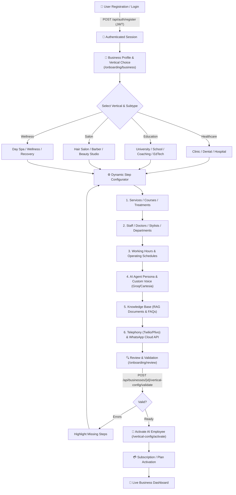
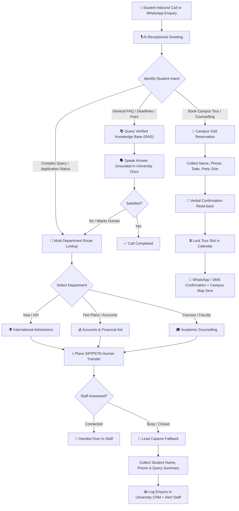
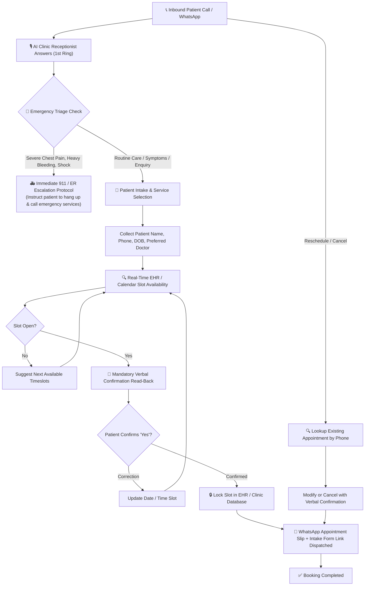
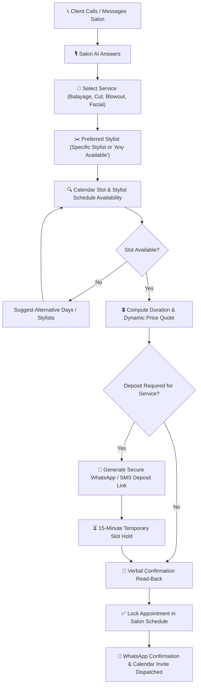
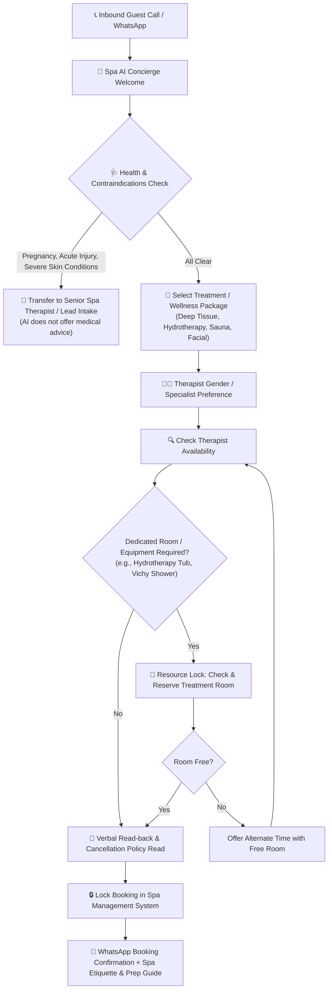

# AMSh Multi-Vertical Architecture & Visual Flowcharts Guide

Welcome to the definitive visual flowcharts and architecture guide for **AMSh (Autonomous AI Employee SaaS)**. 

AMSh is built on a **Generic, Configuration-Driven Multi-Vertical Engine**:
- **Zero hardcoded vertical logic**: The core conversation engine and database are completely vertical-agnostic.
- **Dynamic Onboarding**: Based on the business vertical and subtype chosen, the onboarding wizard loads the exact required steps (services, staff, departments, treatment rooms, working hours, AI agent persona).
- **Dynamic AI Conversation Workflows**: Each vertical executes deterministic state machines and tool calling tailored to its domain (Emergency triage for clinics, Multi-department transfers for universities, Stylist/deposit locks for salons, and Room resource locks for spas).

---

## Table of Contents
1. [Master SaaS Auth & Universal Onboarding Flow](#1-master-saas-auth--universal-onboarding-flow)
2. [Vertical 1: Education & Universities (Admissions & Department Routing)](#2-vertical-1-education--universities)
3. [Vertical 2: Healthcare & Medical Clinics (Intake, Booking & Emergency Triage)](#3-vertical-2-healthcare--medical-clinics)
4. [Vertical 3: Salons & Beauty Studios (Stylists, Slots & Deposits)](#4-vertical-3-salons--beauty-studios)
5. [Vertical 4: Luxury Spas & Wellness (Therapists, Treatment Rooms & Health Check)](#5-vertical-4-luxury-spas--wellness)
6. [Codebase & File Implementation Map](#6-codebase--file-implementation-map)

---

## 1. Master SaaS Auth & Universal Onboarding Flow

Every business owner follows a structured, secure onboarding journey. The system dynamically adapts the form steps according to the selected vertical.

### 🖼️ Visual Flowchart

### 📊 Technical Mermaid Diagram

### Key Stages Explained
1. **User Registration & JWT Auth**: Secure token-based authentication (`POST /api/auth/register` & `/api/auth/login`).
2. **Vertical & Subtype Resolution**: Fetches schema from `GET /api/verticals`. The user chooses vertical and subtype (e.g. `education -> university`).
3. **Dynamic Step Engine**: Frontend loads only the relevant steps defined in `backend/ai/workflows/definitions/{vertical}.yaml`.
4. **Validation & Readiness Check**: Validates that mandatory requirements are met (at least 1 bookable service/course, AI persona selected, timezone configured).
5. **Activation**: System compiles prompt overlays, tool catalogs, and telephony routing.

---

## 2. Vertical 1: Education & Universities

Education is primarily an **inquiry, department routing, and lead-generation** workflow, combined with **campus tour / counselling bookings**.

### 🖼️ Visual Flowchart

### 📊 AI Conversation Mermaid Diagram

### Specific Capabilities in Education:
* **Department Routing**: Intelligent routing based on applicant level (Undergraduate vs. Postgraduate) and origin (Domestic vs. International).
* **Closed-Hours Fallback**: If admissions desks are closed, the AI captures full contact details and logs an enquiry task in the dashboard.
* **Campus Tour Reservations**: Real-time slot booking for Saturday tours or weekday counselling.

---

## 3. Vertical 2: Healthcare & Medical Clinics

Healthcare prioritizes **deterministic patient safety, emergency triage, doctor schedules, and EHR booking**.

### 🖼️ Visual Flowchart

### 📊 AI Conversation Mermaid Diagram

### Specific Capabilities in Healthcare:
* **Strict Emergency Detection**: Deterministic safety checks prevent the AI from offering doctor appointments for life-threatening symptoms.
* **Patient Intake Fields**: Collects name, phone, date of birth, insurance provider, and reason for consultation.
* **Grounding & Read-back**: Code strictly enforces that the appointment is read back before any booking tool executes.

---

## 4. Vertical 3: Salons & Beauty Studios

Salons operate on **stylist preference, multi-service durations, and deposit links**.

### 🖼️ Visual Flowchart

### 📊 AI Conversation Mermaid Diagram

### Specific Capabilities in Salons:
* **Service Durations**: Automatically calculates slot length (e.g., Full Balayage = 180 min, Haircut = 45 min).
* **Stylist Roster**: Respects individual stylist working hours, days off, and specialties.
* **WhatsApp Deposit Links**: Integrates with payment providers (Stripe Global) to prevent no-shows.

---

## 5. Vertical 4: Luxury Spas & Wellness

Spas feature **health contraindications, multi-therapist assignments, and specialized treatment rooms**.

### 🖼️ Visual Flowchart

### 📊 AI Conversation Mermaid Diagram

### Specific Capabilities in Wellness:
* **Dual Resource Allocation**: Allocates both a **Therapist** AND a **Treatment Room** (ResourceAwareWriteOperations) simultaneously.
* **Contraindication Guard**: Protects business liability by transferring pregnant or injured guests to human wellness directors.
* **Package Coordination**: Coordinates multi-hour packages across sequential facilities.

---

## 6. Codebase & File Implementation Map

| Component | Codebase Path | Description |
| :--- | :--- | :--- |
| **Workflow Definitions** | `backend/ai/workflows/definitions/` | YAML configuration for `healthcare.yaml`, `education.yaml`, `salon.yaml`, `wellness.yaml`. |
| **Vertical Prompts** | `backend/ai/prompts/verticals/` | Overlays for system prompts, terminology, and tone per vertical. |
| **Language Packs** | `backend/ai/verticals/configs/` | Multilingual support (English, Hindi, German, Dutch, Arabic) per vertical. |
| **User Onboarding** | `frontend/user/app/onboarding/` | Next.js dynamic step wizard (`/business`, `/services`, `/staff`, `/hours`, `/review`). |
| **Visual Flowcharts** | `DOCS/flowcharts/images/` | High-resolution JPG flowchart infographics for all verticals. |
| **Mermaid Sources** | `DOCS/flowcharts/verticals/` | Source `.mmd` diagrams for system architecture and testing. |

---
*Created for AMSh Autonomous AI Employee Platform.*
