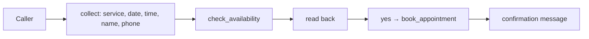

# Healthcare (vertical key `clinic`)

Status: **live** (the existing product). Definition: `backend/ai/workflows/definitions/healthcare.yaml` (v1.0.0,
`workflow_runtime: false`). Every statement about behaviour below is today's behaviour, frozen by
`backend/ai/evals/test_clinic_golden.py`.

## 1. Purpose and subtypes

Answers a practice's phone line (and WhatsApp) 24/7: books, moves and cancels appointments, answers from the clinic's own
facts and documents, and hands emergencies and requests for a person to staff.

| Subtype key | Name | Workflows | Differences |
|---|---|---|---|
| `dental` | Dental practice | booking, change, enquiry | catalogue and doctors only |
| `general_clinic` | General clinic | booking, change, enquiry | the reference behaviour |
| `hospital` | Hospital or medical centre | booking, change, enquiry | usually configures a department directory (billing, specialist desks); without one, transfers ring the fallback number exactly as before |

The three subtypes **genuinely share** the workflows (outpatient appointments). Older businesses with free-text subtypes
("Dental Clinic") run the first subtype's workflows: identical for healthcare. API clients sending `vertical: "hospital"` get
`clinic` / `hospital`.

## 2. Personas and goals

Practice owner (fewer missed calls, full diary), front-desk staff (fewer routine calls, clean handovers), patient (book or
change quickly, reach a person in an emergency).

## 3. Onboarding

Unchanged flow: Business (vertical + subtype now required), Services, Staff, Hours, AI Receptionist, Knowledge, Integrations,
Review (now with the server readiness check and Activate), Plans, Checkout. Validation: name, address, email, phone, subtype
required; services and doctors optional per page (readiness requires at least one bookable service, an agent and a time zone).

## 4. Example configuration and terminology

Patient / Patients, Doctor / Doctors, Treatment / Treatments, Appointment / Appointments. Department templates: `front_desk`,
`emergency` (no AI answer, priority 100), `doctor`, `billing`.

## 5. Dashboard

Unchanged: Dashboard, Appointments, Patients, Doctors, Call Logs; AI settings; Services, Integrations, Analytics; system pages.
New pages (Enquiries, Departments, Transfers) exist but are not in the healthcare sidebar.

## 6. Workflow catalogue

| Workflow | Entry intents | Outcome |
|---|---|---|
| `clinic.appointment_booking` | book_appointment | booked / not_booked |
| `clinic.appointment_change` | reschedule, cancel, status | changed / not_found |
| `clinic.enquiry` | general enquiry, hours, pricing, human request, emergency | answered / transferred / unresolved |

## 7. States and transitions

Booking: `collect` (service, date, time, name, phone) → `check` (check_availability `ok`) → `confirm` (book_appointment:
`needs_confirmation` loops, slot errors return to collect, `booked` completes). Change: `find` (lookup) → `change` (reschedule or
cancel with read-back). Enquiry: `answer` → resolved or `transfer`. These describe the existing controller; healthcare calls do
not run a workflow session.

## 8. Intents and slots

Booking order (unchanged, `controller.SLOT_ORDER` = the workflow's required slot order): service, date, time, name, phone;
optional doctor. The phone is always offered as "the number you're calling from, or another one?".

## 9. Tools

All 9 of today: check_availability, book_appointment, lookup_appointment, cancel_appointment, reschedule_appointment,
send_confirmation, search_knowledge, transfer_to_human, end_call. `capture_enquiry` is **not** offered to healthcare.

## 10. Departments and transfers

Without a department directory (every clinic today): `front_desk` rings the owner's fallback number or the business line,
other departments the first staff member with a phone; a missed transfer speaks the callback line and alerts staff (unchanged).
With a directory (optional, e.g. hospitals): the routing of §11 of the education document applies; emergencies are never
blocked by routing (no open emergency department → the existing emergency path).

## 11. Hours, timeouts, fallbacks

Business hours drive availability; transfer `<Dial timeout="20">`; fallback line "someone will call you back" (unchanged).

## 12. Booking data

`transactions` (type `appointment`), details: patient_name, phone_number, service_name, preferred_date / time, doctor_name,
source, channel, price. Patients: `patients` table plus everyone who booked.

## 13. Follow-ups and integrations

Booking confirmation and reminders (message templates), Google / Outlook calendar sync, Twilio / Plivo / WhatsApp: unchanged.

## 14. Privacy, permissions, safety

No medical advice; emergency detection (English + Hindi) with the region's emergency numbers; health-privacy rules (other
patients' data never disclosed); confirmation before every write.

## 15. Backend

`healthcare.yaml`, `verticals/configs/clinic/*.yaml`, `prompts/receptionist.json` + `engine_notes.json` (base packs, no overlay),
`capabilities/operations/clinic/*`, `engine/agent/*`, routes `appointments`, `customers`, `staff`, `services`.

## 16. Frontend

Unchanged pages; `useVerticalConfig` returns the clinic configuration and every component keeps its clinic labels.

## 17. AI configuration

Base prompt packs (no overlay file for `clinic`); the workflow block is not added (`workflow_runtime: false`).

## 18. Tests and acceptance

`test_clinic_golden.py` (system prompt in 6 settings combinations, tool schemas, scripted controller notes, every engine
message, greetings); all existing agent, voice, security and language suites; `test_a_clinic_without_a_directory_transfers_exactly_as_before`.
Acceptance: golden identical and no new failures (met).

## 19. Limitations and readiness

Production behaviour unchanged. Migration 0015 must run on Postgres before deploying this branch.

## 20. Diagrams

[`../flowcharts/verticals/03_vertical_resolution.mmd`](../flowcharts/verticals/03_vertical_resolution.mmd),
[`12_human_transfer_fallback.mmd`](../flowcharts/verticals/12_human_transfer_fallback.mmd) (directory path, optional for clinics).

